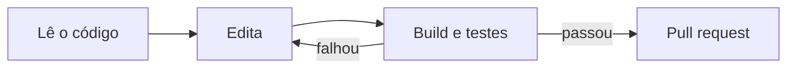

<div
  class="flex flex-col gap-[0.8rem]"
  v-motion
  :initial="{ y: 30, opacity: 0 }"
  :enter="{ y: 0, opacity: 1, transition: { delay: 150 } }"
>
<h1>Integrando o <span class="accent">agente</span></h1>
<p class="lead">IA no seu repositório, tratada como colega de time</p>
</div>

<p class="byline">Rodrigo Nascimento</p>

<!--
Sem introdução sobre IA. Vai direto para o pull request.
-->

---

# Compila. Os testes passam.

<div class="card">

<p class="eyebrow">Pull request</p>

<p class="lead big">Adiciona endpoint para cancelar um pedido</p>

<p class="mt-3">✓ Build &nbsp;&nbsp; ✓ Testes</p>

</div>

<p v-click class="lead big mt-8">E volta do review com <em>três comentários</em>.</p>

<!--
Abre no PR, sem contexto. Um endpoint para cancelar pedido. Build verde, testes verdes.
[click] E mesmo assim volta do review com três comentários.
-->

---

# Três comentários no review

<div class="grid">
<div v-click.hide="3" style="grid-area: 1 / 1">

<<< @/../examples/01-first-pr/src/FirstPr/CancelOrderEndpoint.cs#Cancel cs {all|9|4-5}

</div>
<div v-click="3" style="grid-area: 1 / 1">

<<< @/../examples/01-first-pr/tests/FirstPr.Tests/UnitTest1.cs#Test1 cs {2}

</div>
</div>

<div class="grid mt-4">
<p v-click="[1, 2]" class="lead" style="grid-area: 1 / 1"><b>Review:</b> <code>DateTime.Now</code>? Aqui a gente usa <code>TimeProvider</code>.</p>
<p v-click="[2, 3]" class="lead" style="grid-area: 1 / 1"><b>Review:</b> erro de validação devolve <code>ProblemDetails</code>, não lança exceção.</p>
<p v-click="3" class="lead" style="grid-area: 1 / 1"><b>Review:</b> e o teste se chama <code>Test1</code>.</p>
</div>

<!--
Mostra o código rapidinho, sem ler linha por linha.
[click] Primeiro comentário: DateTime.Now. Aqui a gente usa TimeProvider. Para os estagiários: TimeProvider deixa o teste controlar o relógio.
[click] Segundo: validação lança exceção. Aqui a gente devolve ProblemDetails, o formato padrão de erro em HTTP.
[click] Terceiro: agora o teste que veio no PR. Ele se chama Test1. O nome não diz o que ele testa.
-->

---
class: title-slide
---

# Nada disso está errado em C#.<br>Está errado <span class="accent">aqui</span>.

<p v-click class="lead">Todo mundo aqui já foi essa pessoa: o novato, no primeiro PR, tropeçando em convenções que ninguém escreveu.</p>

<!--
Frase de efeito, devagar. O código funciona; ele só não segue o jeito do time.
[click] Todo mundo aqui já foi o novato. Afirma, não pergunta.
-->

---
class: title-slide
---

<p class="eyebrow">Quem abriu esse PR?</p>

# Um <span class="accent">agente</span>.

<p v-click class="lead big">O novato aprende depois do segundo PR.<br>O agente começa do zero <em>em toda sessão</em>.</p>

<!--
Deixa a revelação respirar. Pausa curta antes de seguir.
[click] A diferença: o novato aprende. O agente começa sem memória nenhuma toda vez.
Transição: "Então quem é esse novo contribuidor, e qual o papel dele no time?"
-->

---

# Autocomplete, chat, agente

<div class="grid grid-cols-3 gap-5">
<div class="card">

### Autocomplete

Sugere a próxima linha.

</div>
<div v-click class="card">

### Chat

Responde perguntas.<br>Você copia e cola.

</div>
<div v-click class="card card-accent">

### Agente

Lê o código, roda comandos, edita, testa e tenta de novo.

</div>
</div>

<p v-click class="lead big mt-8">A diferença é o <em>loop</em>.</p>

<!--
Pergunta que alguém vai ter: "isso não é só o autocomplete do Copilot com mais passos?"
Autocomplete: sugere a próxima linha.
[click] Chat: responde, e você copia e cola.
[click] Agente: um modelo que age no repositório. Lê arquivos, roda comandos, edita, roda os testes, tenta de novo.
[click] A diferença é o loop. Para os estagiários: isso é o que a gente chama de agente.
-->

---

# O agente trabalha em loop



<!--
A partir de um pedido: lê o código. Edita. Roda build e testes.
Se falhou, volta e edita de novo. Se passou, abre o pull request.
É o mesmo ciclo de qualquer pessoa do time.
-->

---

# O agente é um contribuidor

<p class="lead">Contribuidor: qualquer um que altera o projeto.</p>

<v-clicks>

- Mesma **branch**
- Mesmo **pull request**
- Mesmos **checks**
- Mesmo **review**

</v-clicks>

<p v-click class="lead big mt-6">O agente escreve o código.<br>Uma pessoa pediu, uma pessoa revisa, <em>uma pessoa responde por ele</em>.</p>

<!--
Contribuidor: qualquer um que altera o projeto. Uma linha, sem precisar ter visto a apresentação anterior.
[click] Mesma branch.
[click] Mesmo pull request.
[click] Mesmos checks.
[click] Mesmo review.
[click] O agente escreve; quem responde em produção é uma pessoa.
Não entra no mérito de agente ser bom ou ruim: não é o assunto de hoje.
-->

---

# Um prompt melhor toda vez não escala

<p class="lead big">É explicar tudo de novo para o novato toda manhã.</p>

<v-clicks>

- Funciona hoje.
- Some amanhã.
- Cada um explica de um jeito.

</v-clicks>

<!--
A solução óbvia: escrever um prompt melhor toda vez.
É como passar o briefing para o novato em voz alta toda manhã.
[click] Funciona hoje.
[click] Amanhã sumiu.
[click] E cada um de nós explica de um jeito diferente.
Transição: "A gente não integra gente nova falando com ela toda manhã. A gente escreve. Então como é o documento de integração do agente?"
-->

---
class: title-slide
---

<p class="eyebrow">Instruções</p>

# O documento de integração

<p class="lead">Carregado no início de toda sessão: <em>o que é sempre verdade aqui</em>.</p>

<p class="byline"><code>.github/copilot-instructions.md</code></p>

<!--
Instruções: o arquivo que o agente lê no começo de toda sessão. O que é sempre verdade neste repositório.
O exemplo é do Copilot, que é o que a gente usa. A ideia vale para qualquer ferramenta.
-->

---

# Cinco partes, nessa ordem

<v-clicks>

1. **O que é** o repositório, em uma linha
2. **Como compilar e testar**, com os comandos exatos
3. **Nossas convenções**
4. **O que não fazer**
5. **Links** para a documentação que importa

</v-clicks>

<!--
O arquivo da Orders API, parte por parte.
[click] O que é o repositório, em uma linha.
[click] Como compilar e testar, com os comandos exatos.
[click] As convenções.
[click] O que não fazer.
[click] Links para a documentação, em vez de copiar ela.
-->

---

# As convenções viram texto

<<< @/../examples/02-orders-api/.github/copilot-instructions.md#conventions md {all|6-7|2-3}

<!--
As convenções do PR do começo, escritas.
[click] TimeProvider, com o porquê: os testes precisam controlar o relógio.
[click] ProblemDetails, e nunca exceção para validação.
O nome dos testes não está aqui. Ele vai para outro arquivo, daqui a pouco.
-->

---

# O que não fazer, e onde ler mais

<<< @/../examples/02-orders-api/.github/copilot-instructions.md#donts md

<div v-click>

<<< @/../examples/02-orders-api/.github/copilot-instructions.md#more-context md

</div>

<!--
O que não fazer: não adicionar pacote NuGet sem perguntar, não mudar rota sem avisar no PR.
[click] E um link para a documentação de verdade, em vez de copiar ela aqui.
-->

---

# O que fica de fora

<p class="lead big">Se uma pessoa não leria no primeiro dia,<br>o agente também não deveria ler.</p>

<v-clicks>

- ✘ O que o linter e o formatter já garantem
- ✘ Textos longos e ensaios
- ✘ Segredos
- ✘ O que muda toda semana

</v-clicks>

<!--
A regra: se uma pessoa não leria no primeiro dia, o agente também não.
[click] O que o linter e o formatter já garantem: a ferramenta faz melhor.
[click] Textos longos.
[click] Segredos, nunca.
[click] O que muda toda semana: vai estar errado semana que vem.
-->

---

# Regras de teste só valem nos testes

<<< @/../examples/02-orders-api/.github/instructions/tests.instructions.md md {all|2|6|7}

<!--
Instruções com escopo: regras que só valem para alguns arquivos.
[click] applyTo: "tests/**". Para os estagiários: isso é um glob, um padrão de caminho. "tests/**" é tudo dentro da pasta tests.
[click] O terceiro comentário do PR, o nome dos testes, mora aqui: só importa nos testes.
[click] E "todo endpoint tem teste" também mora aqui. Guarda essa linha: ela volta já já.
-->

---

# De novo, agora com instruções

<div class="grid grid-cols-[9rem_1fr] gap-x-6 gap-y-4 items-baseline">
<h3>Pedido</h3>
<p class="m-0">"Adicione um endpoint para cancelar um pedido"</p>
<h3 v-click="1">Leu</h3>
<p v-click="1" class="m-0"><code>.github/copilot-instructions.md</code></p>
<h3 v-click="2">Fez</h3>
<p v-click="2" class="m-0">✓ <code>TimeProvider</code> &nbsp; ✓ <code>ProblemDetails</code></p>
<h3 v-click="3" class="accent">Pull request</h3>
<p v-click="3" class="m-0 lead big">✘ sem teste</p>
</div>

<!--
O mesmo pedido do começo, passo a passo.
[click] O agente leu o arquivo de instruções no início da sessão.
[click] Usou TimeProvider e ProblemDetails.
[click] Mas o pull request veio sem teste.
-->

---
class: title-slide
---

<p class="eyebrow">Por que faltou o teste?</p>

<p class="lead big">"Todo endpoint tem teste" mora em <code>tests.instructions.md</code>.</p>

<p v-click class="lead big">O agente nunca abriu <code>tests/</code>.<br><em>Então nunca viu a regra.</em></p>

<p v-click class="lead">Instruções com escopo valem para os arquivos editados.<br>Elas não dizem quais arquivos criar.</p>

<!--
A regra de "todo endpoint tem teste" está no arquivo com escopo de testes.
[click] Esse arquivo só carrega quando o agente mexe em tests/. Ele nunca abriu um arquivo de teste, então nunca viu a regra.
[click] Instruções com escopo valem para o que está sendo editado. Não dizem o que criar.
-->

---

# Instruções orientam, não garantem

<div class="cols">
<div class="card">

### "Dá mais trabalho que corrigir o PR"

Escreve uma vez.<br>Toda sessão e todo novato reaproveitam.

</div>
<div v-click class="card">

### "Às vezes ele ignora"

Formatter, analyzers e testes no PR garantem.<br>O review pega o resto.

</div>
</div>

<!--
Responde ao cético antes que ele pergunte.
"Dá mais trabalho que corrigir o PR?" Escreve uma vez, toda sessão e todo novato reaproveitam.
[click] "Ele às vezes ignora as instruções." Sim: instruções orientam, não garantem. Quem garante são os checks no PR, e o review humano pega o resto.
Transição: "Instruções dizem o que é verdade. Não dizem como fazer um trabalho passo a passo. 'Adicionar um endpoint' é um procedimento."
-->

---
class: title-slide
---

<p class="eyebrow">Skills</p>

# O passo a passo

<p class="lead">Carregada só quando a tarefa pede: <em>como a gente faz X aqui</em>.</p>

<p class="byline"><code>.github/skills/add-endpoint/SKILL.md</code></p>

<!--
Pergunta: onde eu coloco "como a gente faz X" sem inchar as instruções?
Skill: um procedimento que o agente só carrega quando a tarefa precisa dele.
É uma pasta com um arquivo SKILL.md dentro.
-->

---

# Adicionar um endpoint, passo a passo

<<< @/../examples/02-orders-api/.github/skills/add-endpoint/SKILL.md#add-an-endpoint md {all|3-5|6-7|9-10|12}

<!--
O corpo da skill: os passos, na ordem em que uma pessoa do time faria.
[click] A rota, no lugar de sempre.
[click] Validação devolvendo ProblemDetails, nunca exceção.
[click] Os testes: o caso de sucesso e um por erro. É aqui que entra o teste que faltou.
[click] E roda dotnet test antes de dizer que terminou.
-->

---

# A descrição decide se a skill é usada

<<< @/../examples/02-orders-api/.github/skills/add-endpoint/SKILL.md#frontmatter md {all|2|3-4}

<p v-click="3" class="lead mt-6">No início da sessão, o agente só lê nome e descrição.<br>O resto carrega quando o pedido combina com a descrição.</p>

<!--
O cabeçalho da skill.
[click] O nome, igual ao da pasta.
[click] A descrição: diz quando usar a skill.
[click] No começo da sessão, o agente só vê nome e descrição de cada skill. É barato. O corpo só carrega quando o pedido combina. Então a descrição decide se a skill vai ser usada um dia.
-->

---

# Escreva a descrição como um termo de busca

<div class="cols">
<div class="card">

### ✘ Vaga

<p class="lead">"Endpoint stuff"</p>

</div>
<div v-click class="card card-accent">

### ✓ Diz quando usar

<p class="lead">"Use when adding or changing an HTTP endpoint in the Orders API: route, validation, error responses, tests and docs."</p>

</div>
</div>

<p v-click class="lead mt-8">O formato <code>SKILL.md</code> é um padrão aberto: o mesmo arquivo serve em outras ferramentas.</p>

<!--
Uma descrição vaga: "Endpoint stuff". O agente não tem como saber quando usar.
[click] Uma boa: começa com "Use when", e cita as palavras que vão aparecer no pedido.
[click] E um bônus: SKILL.md é um padrão aberto, o mesmo formato em várias ferramentas. É o único lugar onde a portabilidade sai de graça.
Se perguntarem de prompt files: fora do escopo de hoje.
-->

---

# De novo, agora com uma skill

<div class="grid grid-cols-[9rem_1fr] gap-x-6 gap-y-4 items-baseline">
<h3>Pedido</h3>
<p class="m-0">"Adicione um endpoint para cancelar um pedido"</p>
<h3 v-click="1">Carregou</h3>
<p v-click="1" class="m-0">a skill <code>add-endpoint</code>, pela descrição</p>
<h3 v-click="2">Fez</h3>
<p v-click="2" class="m-0">✓ <code>TimeProvider</code> &nbsp; ✓ <code>ProblemDetails</code> &nbsp; ✓ testes</p>
<h3 v-click="3" class="accent">Pull request</h3>
<p v-click="3" class="m-0 lead big">✓ com teste</p>
</div>

<!--
O mesmo pedido, agora com a skill no repositório.
[click] O pedido combina com a descrição, e o agente carrega a skill add-endpoint.
[click] Segue os passos: TimeProvider, ProblemDetails, e os testes, porque o passo 5 manda.
[click] O pull request vem com teste.
Transição: "Instruções e skills mudam como o agente trabalha. Às vezes você quer que ele faça outro trabalho, como revisar em vez de escrever."
-->

---
class: title-slide
---

<p class="eyebrow">Agentes personalizados</p>

# Os papéis

<p class="lead">Outro trabalho, com instruções e ferramentas próprias.</p>

<p class="byline"><code>.github/agents/reviewer.agent.md</code></p>

<!--
Agente personalizado: um papel. Instruções próprias, às vezes menos ferramentas, e você escolhe ele para um tipo de trabalho.
-->

---

# O revisor lê e comenta, mas nunca edita

<<< @/../examples/02-orders-api/.github/agents/reviewer.agent.md#frontmatter md {all|3-4|5}

<!--
O exemplo: um revisor, que confere a mudança contra as nossas convenções antes do PR.
[click] A descrição diz o trabalho dele.
[click] E as ferramentas: só ler e buscar. Ele não tem como editar código: quem é dono da mudança é o autor.
Abaixo do cabeçalho vem o corpo: o que conferir, como um checklist de review.
-->

---

# Qual arquivo? Depende da regra

<div class="grid grid-cols-[1fr_auto] gap-x-10 gap-y-4 items-baseline">
<p class="m-0 lead">Se a regra é…</p>
<p class="m-0 lead">vai em</p>
<p v-click="1" class="m-0">sempre verdade neste repositório</p>
<h3 v-click="1" class="m-0">instruções</h3>
<p v-click="2" class="m-0">verdade só para alguns arquivos</p>
<h3 v-click="2" class="m-0">instruções com escopo</h3>
<p v-click="3" class="m-0">um procedimento para um tipo de tarefa</p>
<h3 v-click="3" class="m-0">skill</h3>
<p v-click="4" class="m-0">um trabalho diferente</p>
<h3 v-click="4" class="m-0">agente personalizado</h3>
</div>

<!--
Pergunta: tenho uma regra na cabeça. Em qual arquivo ela vai?
[click] Sempre verdade neste repositório: instruções.
[click] Só para alguns arquivos: instruções com escopo.
[click] Um procedimento para um tipo de tarefa: skill.
[click] Um trabalho diferente: agente personalizado.
-->

---

# Onde mora cada regra?

<div class="grid grid-cols-[1fr_auto] gap-x-10 gap-y-5 items-baseline">
<p class="m-0 lead">Os testes seguem <code>Method_Scenario_Expected</code></p>
<h3 v-click="1" class="m-0 accent">instruções com escopo</h3>
<p class="m-0 lead">Como adicionar o teste de integração de um endpoint</p>
<h3 v-click="2" class="m-0 accent">skill</h3>
<p class="m-0 lead">Revise meu PR antes de eu abrir</p>
<h3 v-click="3" class="m-0 accent">agente personalizado</h3>
</div>

<!--
Pergunta rápida: responde no chat ou em voz alta. Menos de um minuto.
Se ninguém responder, responde a primeira e segue.
[click] Nome dos testes: instruções com escopo, só vale em tests/.
[click] Adicionar um teste de integração: skill. Se alguém disser "instruções com escopo": o nome é uma regra, os passos são uma skill.
[click] Revisar o PR: agente personalizado, é outro trabalho.
Transição: "Agora a gente tem arquivos. Mas arquivo que o agente não acha é como se não existisse. Como ele acha?"
-->

---
class: title-slide
---

<p class="eyebrow">Descoberta</p>

# Como o agente acha os arquivos

<p class="lead">Arquivo que o agente não acha é como se não existisse.</p>

<!--
Pergunta: como o agente sabe que esses arquivos existem?
Entender isso é o que faz a gente colocar cada arquivo no lugar certo.
-->

---

# Cada arquivo carrega em um momento

<div class="grid grid-cols-[14rem_1fr] gap-x-6 gap-y-4 items-baseline">
<p class="m-0 lead">Quando…</p>
<p class="m-0 lead">o agente carrega</p>
<h3 v-click="1" class="m-0">a sessão começa</h3>
<p v-click="1" class="m-0"><code>copilot-instructions.md</code></p>
<h3 v-click="2" class="m-0">mexe em um arquivo</h3>
<p v-click="2" class="m-0">as instruções cujo <code>applyTo</code> combina</p>
<h3 v-click="3" class="m-0">chega um pedido</h3>
<p v-click="3" class="m-0">a skill cuja descrição combina</p>
<h3 v-click="4" class="m-0">você escolhe</h3>
<p v-click="4" class="m-0">o agente personalizado<br>ou o Copilot delega a ele, como subagente</p>
</div>

<!--
Uma linha por momento, na ordem em que acontecem.
[click] A sessão começa: as instruções do repositório inteiro carregam.
[click] O agente mexe em um arquivo: entram as instruções com escopo cujo applyTo combina.
[click] Chega um pedido: as descrições das skills são comparadas, e a que combina carrega.
[click] Agentes personalizados: normalmente você escolhe. No VS Code e no GitHub, o Copilot também pode passar parte da tarefa para um deles sozinho, como subagente. Para os estagiários: subagente é um agente auxiliar que o agente principal chama para uma subtarefa. Dá para desligar com disable-model-invocation: true. A documentação do Visual Studio só fala de escolher manualmente.
-->

---

# A pasta errada não dá erro

<div class="cols items-start">
<div>

```text
orders-api/
├─ .github/
│  ├─ copilot-instructions.md
│  ├─ instructions/
│  │  └─ tests.instructions.md
│  ├─ skills/
│  │  └─ add-endpoint/SKILL.md
│  └─ agents/
│     └─ reviewer.agent.md
├─ src/
└─ tests/
```

</div>
<div v-click>

<p class="lead">Padrões abertos, na raiz:</p>

- `AGENTS.md`
- `.agents/skills/`

<p class="lead mt-4">A mesma ideia em outras ferramentas:</p>

- `.claude/`

</div>
</div>

<p v-click class="lead big mt-6">Arquivo fora do lugar é <em>ignorado em silêncio</em>.</p>

<!--
O mapa de pastas do repositório de exemplo. Tudo dentro de .github: instruções, instruções com escopo, skills, agentes.
[click] Os padrões abertos ficam na raiz: AGENTS.md e .agents/skills. E outras ferramentas têm a mesma ideia em pastas próprias, como .claude.
[click] E o mais importante: pasta errada não dá erro nenhum. O arquivo só é ignorado. Pasta errada, nenhum erro. Fala duas vezes.
-->

---

<h1>AGENTS.md compensa com mais de uma ferramenta</h1>

<div class="cols">
<div class="card">

### `.github/copilot-instructions.md`

Lido pelo Copilot.

</div>
<div class="card">

### `AGENTS.md`

Formato aberto, "um README para agentes", lido por várias ferramentas.<br>Arquivos aninhados: o mais próximo vence.

</div>
</div>

<div class="mt-6">
<v-clicks>

- Uma ferramenta só? O arquivo dela basta. Mudar depois é pequeno.
- De qualquer jeito: <em>uma fonte de verdade</em>, nunca as mesmas regras em dois arquivos.

</v-clicks>
</div>

<!--
O mesmo conteúdo pode morar em dois lugares.
O arquivo do Copilot, que é o que a gente viu até agora.
AGENTS.md: um formato aberto, "um README para agentes", lido por muitas ferramentas. Em subpastas, o arquivo mais próximo do código vence.
[click] Compensa quando mais de uma ferramenta mexe no repositório. Com uma ferramenta só, o arquivo dela basta. Mudar depois é pequeno, e o próprio agente faz.
[click] Seja qual for: uma fonte de verdade. Nunca as mesmas regras em dois arquivos.
-->

---

# Fácil de achar, barato de carregar

<v-clicks>

- Cada arquivo **exatamente onde a ferramenta procura**
- Descrições escritas como **termos de busca**
- **Link** para a documentação, em vez de copiar
- Arquivo principal **curto**: tudo nele custa contexto em todo pedido

</v-clicks>

<!--
Como ajudar a descoberta.
[click] O arquivo exatamente onde a ferramenta procura. Pasta errada, nenhum erro: segunda vez que eu falo.
[click] Descrições como termos de busca: as palavras que vão aparecer no pedido.
[click] Link em vez de cópia: "convenções da API: docs/api.md".
[click] O arquivo principal curto: ele carrega em todo pedido. Para os estagiários: contexto é o que o agente consegue ter em mente de uma vez.
Transição: "Isso cobre um repositório. Mas a gente tem vários, e muita coisa é igual em todos."
-->

---
class: title-slide
---

# Copiar tudo para todo repositório?

<p v-click class="lead big">Fatos sobre <em>este código</em> moram com o código.</p>

<p v-click class="lead big">O que vale para <em>todo</em> repositório pode ser compartilhado.</p>

<!--
Pergunta: eu copio tudo isso para todo repositório?
[click] O princípio: o que fala deste código mora com o código.
[click] O que vale para todo repositório, como um papel de revisor ou como a gente escreve PR, é candidato a ser compartilhado.
-->

---

# Dois jeitos, cada um com seu custo

<div class="cols">
<div v-click class="card">

### Repositório compartilhado

<p class="eyebrow">como arquivos de usuário</p>

- ✓ Um lugar para melhorar
- ✓ Sem cópias divergindo
- ✘ Só funciona onde foi configurado
- ✘ Versionado longe do código
- ✘ Agentes na nuvem e review no GitHub não veem

</div>
<div v-click class="card">

### Arquivos em cada repositório

<p class="eyebrow">junto com o código</p>

- ✓ Revisados no mesmo PR do código
- ✓ Funcionam para quem clona
- ✓ Valem na nuvem também
- ✘ Arquivos comuns são copiados e divergem

</div>
</div>

<!--
Sem veredito. Os dois lados com o mesmo peso.
[click] Repositório compartilhado, configurado como arquivos de usuário: um lugar só para melhorar, sem cópias divergindo, os mesmos agentes para todo mundo. Mas só funciona na máquina onde foi configurado, e cada pessoa nova tem que configurar. Fica versionado longe do código. E agentes na nuvem e o review do Copilot no GitHub não enxergam.
[click] Arquivos em cada repositório: revisados no mesmo PR do código, funcionam para qualquer um que clona, nuvem incluída. Mas o que é comum acaba copiado, e as cópias divergem.
-->

---

# O que cita este código fica neste repositório

<v-clicks>

- Papéis e skills genéricos: **compartilhados**
- O que cita o código deste repositório: **no repositório**
- As instruções de cada repositório **dizem quais arquivos compartilhados existem**

</v-clicks>

<!--
Um meio-termo possível, não uma regra.
[click] Papéis e skills genéricos, como o revisor: compartilhados.
[click] Tudo que cita o código deste repositório fica nele.
[click] E as instruções de cada repositório avisam quais arquivos compartilhados existem.
Transição: "De volta ao novato do começo."
-->

---

# O primeiro PR, de novo

<div class="grid grid-cols-[9rem_1fr] gap-x-6 gap-y-4 items-baseline">
<h3>Instruções</h3>
<p class="m-0">✓ <code>TimeProvider</code> &nbsp; ✓ <code>ProblemDetails</code></p>
<h3 v-click="1">Skill</h3>
<p v-click="1" class="m-0">✓ testes, com o nome no padrão</p>
<h3 v-click="2">Revisor</h3>
<p v-click="2" class="m-0">✓ convenções conferidas antes do PR</p>
<h3 v-click="3" class="accent">Review</h3>
<p v-click="3" class="m-0 lead big">sobre a mudança, não sobre as convenções</p>
</div>

<!--
O PR do começo, agora com tudo no lugar.
As instruções: TimeProvider e ProblemDetails.
[click] A skill: os testes, com o nome no padrão.
[click] O revisor conferiu as convenções antes de abrir o PR.
[click] E o review humano fica sobre a mudança em si, não sobre as nossas convenções. Quase sempre: instruções orientam, os checks e o review pegam o resto.
-->

---

# O checklist do primeiro dia

<p class="lead mb-4">O que você daria ao novato é o que você dá ao agente.</p>

<v-clicks>

1. Um arquivo de instruções curto: build, testes, convenções, o que não fazer
2. Uma skill para a tarefa que você mais repete
3. Instruções com escopo só onde a regra muda de verdade
4. Todo trabalho dele passa por PR e por review humano, sempre

</v-clicks>

<!--
Pergunta: então o que eu faço na segunda-feira?
O que você daria para uma pessoa nova é o que você dá para o agente.
[click] Um arquivo de instruções curto.
[click] Uma skill, para a tarefa que você mais repete.
[click] Instruções com escopo só onde a regra é diferente de verdade.
[click] E todo trabalho dele passa por PR e por review humano. Sempre.
-->

---

# Não escreva tudo de uma vez

<p class="lead big">Comece pelos comandos de build e teste.</p>

<v-clicks>

- O mesmo comentário de review apareceu duas vezes? Vira uma linha.
- Regra que ninguém precisou ainda é só contexto a mais para carregar.

</v-clicks>

<!--
Quando não fazer: não escreve tudo antes.
Começa pelos comandos de build e teste.
[click] Apareceu o mesmo comentário de review duas vezes? Vira uma linha no arquivo.
[click] Uma regra que ninguém precisou ainda é só mais contexto para carregar.
-->

---
class: title-slide
---

# O agente é o novato <span class="accent">em toda sessão</span>.

<p v-click class="lead big">Escreva a integração dele no repositório,<br>e revise o trabalho dele como o de qualquer pessoa.</p>

<!--
A mensagem final. Devagar.
[click] Escreva a integração dele no repositório, e revise o trabalho dele como o de qualquer pessoa.
Depois para de falar.
-->

---
class: title-slide
---

<p class="eyebrow">Vamos conversar</p>

# Qual comentário de review você já escreveu duas vezes?

<div class="mt-6">

**Artigo:** rodrigofnascimento.github.io/onboarding-the-agent<br>
**Repositório:** github.com/RodrigoFNascimento/onboarding-the-agent

</div>

<!--
Abre a discussão. A resposta é a primeira linha do arquivo de instruções de alguém.
O repositório de exemplo serve de ponto de partida.
-->
