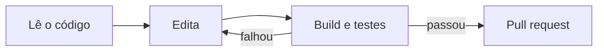

<h1>Integrando o agente</h1>

IA no seu repositório, tratada como colega de time

Rodrigo Nascimento

<!--
Sem introdução sobre IA. Vai direto para o pull request.
-->

---

# Compila. Os testes passam.

Pull request

Adiciona endpoint para cancelar um pedido

✔ Build &nbsp;&nbsp; ✔ Testes

E volta do review com <em>três comentários</em>.

<!--
Abre no PR, sem contexto. Um endpoint para cancelar pedido. Build verde, testes verdes.
[click] E mesmo assim volta do review com três comentários.
-->

---

# Três comentários no review

<<< @/../examples/01-first-pr/src/FirstPr/CancelOrderEndpoint.cs#Cancel cs {all|9|4-5}

<<< @/../examples/01-first-pr/tests/FirstPr.Tests/UnitTest1.cs#Test1 cs {2}

<b>Review:</b> <code>DateTime.Now</code>? Aqui a gente usa <code>TimeProvider</code>.

<b>Review:</b> erro de validação devolve <code>ProblemDetails</code>, não lança exceção.

<b>Review:</b> e o teste se chama <code>Test1</code>.

<!--
Mostra o código rapidinho, sem ler linha por linha.
[click] Primeiro comentário: DateTime.Now. Aqui a gente usa TimeProvider. Para os estagiários: TimeProvider deixa o teste controlar o relógio.
[click] Segundo: validação lança exceção. Aqui a gente devolve ProblemDetails, o formato padrão de erro em HTTP.
[click] Terceiro: agora o teste que veio no PR. Ele se chama Test1. O nome não diz o que ele testa.
-->

---
class: title-slide
---

# Nada disso está errado em C#. Está errado aqui.

Todo mundo aqui já foi essa pessoa: o novato, no primeiro PR, tropeçando em convenções que ninguém escreveu.

<!--
Frase de efeito, devagar. O código funciona; ele só não segue o jeito do time.
[click] Todo mundo aqui já foi o novato. Afirma, não pergunta.
-->

---
class: title-slide
---

Quem abriu esse PR?

# Um agente.

O novato aprende depois do segundo PR. O agente começa do zero <em>em toda sessão</em>.

<!--
Deixa a revelação respirar. Pausa curta antes de seguir.
[click] A diferença: o novato aprende. O agente começa sem memória nenhuma toda vez.
Transição: "Então quem é esse novo contribuidor, e qual o papel dele no time?"
-->

---

# Autocomplete, chat, agente

### Autocomplete

Sugere a próxima linha.

### Chat

Responde perguntas. Você copia e cola.

### Agente

Lê o código, roda comandos, edita, testa e tenta de novo.

A diferença é o <em>loop</em>.

<!--
Pergunta que alguém vai ter: "isso não é só o autocomplete do Copilot com mais passos?"
Autocomplete: sugere a próxima linha.
[click] Chat: responde, e você copia e cola.
[click] Agente: um modelo que age no repositório. Lê arquivos, roda comandos, edita, roda os testes, tenta de novo.
[click] A diferença é o loop. Para os estagiários: isso é o que a gente chama de agente.
-->

---

# O agente trabalha em loop

<!--
A partir de um pedido: lê o código. Edita. Roda build e testes.
Se falhou, volta e edita de novo. Se passou, abre o pull request.
É o mesmo ciclo de qualquer pessoa do time.
-->

---

# O agente é um contribuidor

Contribuidor: qualquer um que altera o projeto.

<v-clicks>

- Mesma **branch**
- Mesmo **pull request**
- Mesmos **checks**
- Mesmo **review**

</v-clicks>

O agente escreve o código. Uma pessoa pediu, uma pessoa revisa, <em>uma pessoa responde por ele</em>.

<!--
Contribuidor: qualquer um que altera o projeto. Uma linha, sem precisar ter visto a apresentação anterior.
[click] Mesma branch.
[click] Mesmo pull request.
[click] Mesmos checks.
[click] Mesmo review.
[click] O agente escreve; quem responde em produção é uma pessoa.
Não entra no mérito de agente ser bom ou ruim: não é o assunto de hoje.
-->

---

# Um prompt melhor toda vez não escala

É explicar tudo de novo para o novato toda manhã.

<v-clicks>

- Funciona hoje.
- Some amanhã.
- Cada um explica de um jeito.

</v-clicks>

<!--
A solução óbvia: escrever um prompt melhor toda vez.
É como passar o briefing para o novato em voz alta toda manhã.
[click] Funciona hoje.
[click] Amanhã sumiu.
[click] E cada um de nós explica de um jeito diferente.
Transição: "A gente não integra gente nova falando com ela toda manhã. A gente escreve. Então como é o documento de integração do agente?"
-->

---
class: title-slide
---

Instruções

# O documento de integração

Carregado no início de toda sessão: <em>o que é sempre verdade aqui</em>.

<code>.github/copilot-instructions.md</code>

<!--
Instruções: o arquivo que o agente lê no começo de toda sessão. O que é sempre verdade neste repositório.
O exemplo é do Copilot, que é o que a gente usa. A ideia vale para qualquer ferramenta.
-->

---

# Cinco partes, nessa ordem

<v-clicks>

1. **O que é** o repositório, em uma linha
2. **Como compilar e testar**, com os comandos exatos
3. **Nossas convenções**
4. **O que não fazer**
5. **Links** para a documentação que importa

</v-clicks>

<!--
O arquivo da Orders API, parte por parte.
[click] O que é o repositório, em uma linha.
[click] Como compilar e testar, com os comandos exatos.
[click] As convenções.
[click] O que não fazer.
[click] Links para a documentação, em vez de copiar ela.
-->

---

# As convenções viram texto

<<< @/../examples/02-orders-api/.github/copilot-instructions.md#conventions md {all|6-7|2-3}

<!--
As convenções do PR do começo, escritas.
[click] TimeProvider, com o porquê: os testes precisam controlar o relógio.
[click] ProblemDetails, e nunca exceção para validação.
O nome dos testes não está aqui. Ele vai para outro arquivo, daqui a pouco.
-->

---

# O que não fazer, e onde ler mais

<<< @/../examples/02-orders-api/.github/copilot-instructions.md#donts md

<<< @/../examples/02-orders-api/.github/copilot-instructions.md#more-context md

<!--
O que não fazer: não adicionar pacote NuGet sem perguntar, não mudar rota sem avisar no PR.
[click] E um link para a documentação de verdade, em vez de copiar ela aqui.
-->

---

# O que fica de fora

Se uma pessoa não leria no primeiro dia, o agente também não deveria ler.

<v-clicks>

- ✘ O que o linter e o formatter já garantem
- ✘ Textos longos e ensaios
- ✘ Segredos
- ✘ O que muda toda semana

</v-clicks>

<!--
A regra: se uma pessoa não leria no primeiro dia, o agente também não.
[click] O que o linter e o formatter já garantem: a ferramenta faz melhor.
[click] Textos longos.
[click] Segredos, nunca.
[click] O que muda toda semana: vai estar errado semana que vem.
-->

---

# Regras de teste só valem nos testes

<<< @/../examples/02-orders-api/.github/instructions/tests.instructions.md md {all|2|6|7}

<!--
Instruções com escopo: regras que só valem para alguns arquivos.
[click] applyTo: "tests/**". Para os estagiários: isso é um glob, um padrão de caminho. "tests/**" é tudo dentro da pasta tests.
[click] O terceiro comentário do PR, o nome dos testes, mora aqui: só importa nos testes.
[click] E "todo endpoint tem teste" também mora aqui. Guarda essa linha: ela volta já já.
-->

---

# De novo, agora com instruções

<h3>Pedido</h3>

"Adicione um endpoint para cancelar um pedido"

<h3 v-click="1">Leu</h3>

<code>.github/copilot-instructions.md</code>

<h3 v-click="2">Fez</h3>

✔ <code>TimeProvider</code> &nbsp; ✔ <code>ProblemDetails</code>

<h3 v-click="3" class="accent">Pull request</h3>

✘ sem teste

<!--
O mesmo pedido do começo, passo a passo.
[click] O agente leu o arquivo de instruções no início da sessão.
[click] Usou TimeProvider e ProblemDetails.
[click] Mas o pull request veio sem teste.
-->

---
class: title-slide
---

Por que faltou o teste?

"Todo endpoint tem teste" mora em <code>tests.instructions.md</code>.

O agente nunca abriu <code>tests/</code>. <em>Então nunca viu a regra.</em>

Instruções com escopo valem para os arquivos editados. Elas não dizem quais arquivos criar.

<!--
A regra de "todo endpoint tem teste" está no arquivo com escopo de testes.
[click] Esse arquivo só carrega quando o agente mexe em tests/. Ele nunca abriu um arquivo de teste, então nunca viu a regra.
[click] Instruções com escopo valem para o que está sendo editado. Não dizem o que criar.
-->

---

# Instruções orientam, não garantem

### "Dá mais trabalho que corrigir o PR"

Escreve uma vez. Toda sessão e todo novato reaproveitam.

### "Às vezes ele ignora"

Formatter, analyzers e testes no PR garantem. O review pega o resto.

<!--
Responde ao cético antes que ele pergunte.
"Dá mais trabalho que corrigir o PR?" Escreve uma vez, toda sessão e todo novato reaproveitam.
[click] "Ele às vezes ignora as instruções." Sim: instruções orientam, não garantem. Quem garante são os checks no PR, e o review humano pega o resto.
Transição: "Instruções dizem o que é verdade. Não dizem como fazer um trabalho passo a passo. 'Adicionar um endpoint' é um procedimento."
-->
